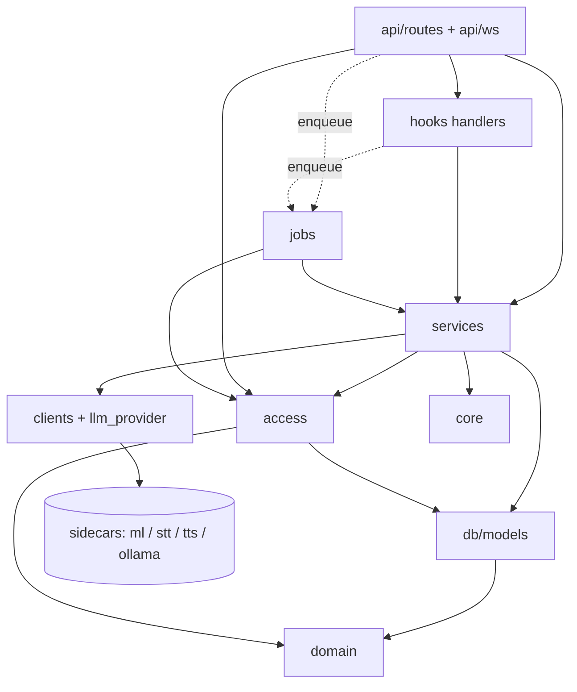
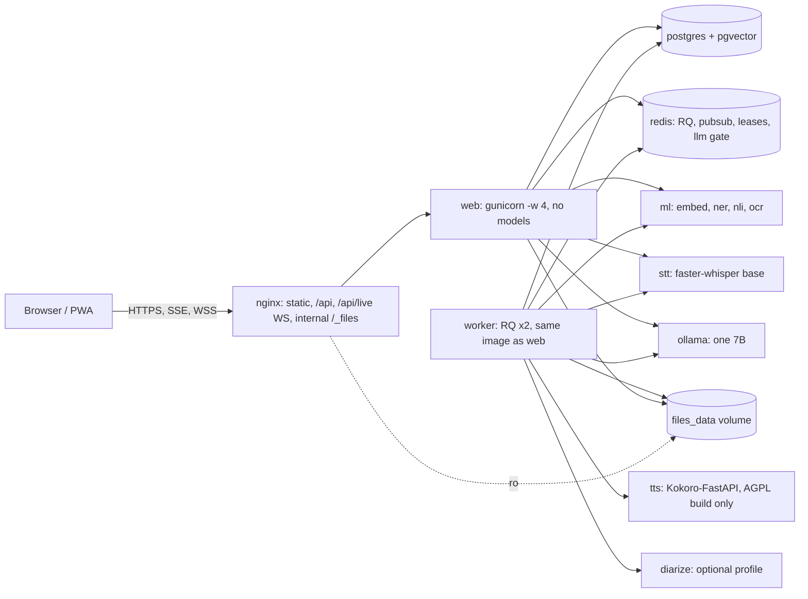
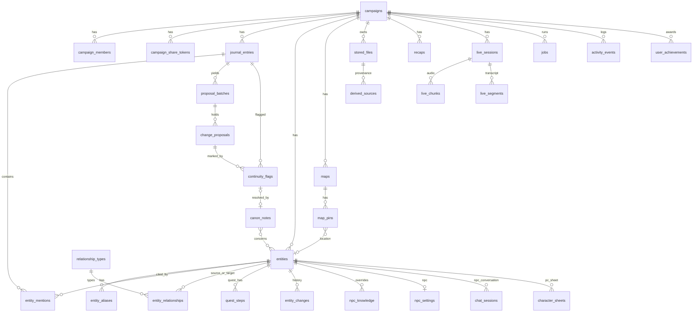

# Architecture Spine: Lorekeeper living campaign world

This is a brownfield system. Backend paths are relative to `src/backend/`, frontend paths to `src/frontend/src/`, and infra paths to the repo root. Terms follow PRD §3 exactly.

Owner decisions (round 2 in `scope-input.md`) override the PRD where they conflict:
- The Reference Box is 16 GB with one profile.
- Existing Members become Players.
- Kokoro and espeak-ng ship only as an optional container in the AGPL build.
- Tests use the `docker-compose.dev.yml` Postgres.

Numbers marked **(SPIKE-n)** were measured on an M-series Mac in `spikes/cpu-benchmarks.md`. They are optimistic and need a re-run on x86. The rules around them are fixed.

## Design Paradigm

**Layered modular monolith, with one job worker and model-service sidecars.** The paradigm is ratified from the existing code.

- One codebase and one image (`src/backend`) run in two roles: `web` (gunicorn/uvicorn) and `worker` (RQ).
- Every ML model runs in a sidecar reached over internal HTTP.
- Import rules are enforced in CI by `import-linter` contracts generated from the table below.

| Layer | Directory | May import |
| --- | --- | --- |
| Transport | `app/api/routes/*.py`, `app/api/deps.py`, `app/api/ws/*.py` | everything below |
| Hook handlers | `app/hooks/<feature>.py` | services, jobs.enqueue, access, schemas, domain, core |
| Jobs | `app/jobs/*.py` | services, access, schemas, domain, core |
| Services (module-level functions) | `app/services/*.py` | access, clients, db, schemas, domain, core |
| Access policy | `app/access/` (`policy.py`, `registry.py`, `audience.py`) | db, schemas, domain, core |
| Model clients | `app/clients/{ml,stt,tts}.py`, `app/services/llm_provider.py` | domain, core |
| Persistence | `app/db/models/*.py`, `migrations/` | db base, domain |
| Domain data (pure) | `app/domain/*.py` (enums, entity types, narrators, achievements) | nothing |
| Cross-cutting | `app/core/*` (config, errors, sse, pubsub, llm_gate, logging, limiter) | domain |



Services never import routes, hook handlers or jobs, except `jobs.enqueue`. The web and worker images never install torch, spaCy, sentence-transformers, whisper, easyocr, onnxruntime or any TTS package.

## Invariants & Rules

### AD-1: Layering and no in-process models [ADOPTED + extended]

- **Binds:** all; NFR-2, NFR-3
- **Prevents:** any epic loading a model inside the web workers, which multiplies RAM by the worker count (today about 11.9 GB at peak); business logic in routes; import cycles.
- **Rule:**
  - **Inference.** Follow the layer table. All inference goes through `app/clients/*` or `llm_provider`.
  - **Wrappers.** `nlp_service`, `embedding_service`, `transcription_service` and `vision_service` become async client wrappers: `async def embed(text)`, `async def extract_tags(text)` and so on. Their callers are updated in the same PR.
  - **Lifespan.** The `main.py` lifespan stops loading models.
  - **CI.** CI fails if the web or worker requirements list a model package.

### AD-2: One job system: RQ transport, Postgres authority

- **Binds:** FR-1, FR-2, FR-13, FR-18, FR-19, FR-29, FR-30, FR-32, FR-47, FR-52, FR-5 backfills, NFR-9
- **Prevents:** epics inventing `BackgroundTasks`, `asyncio.create_task` or threads; job state split between Redis and the DB; Jobs lost to a Redis flush or a crash.
- **Rule:**
  - **The job row.** Background work exists only as a `jobs` row created by `app/jobs/enqueue.py: enqueue(db, ctx, kind, payload, *, idempotency_key)`. `enqueue` has no `queue` parameter. The queue comes from the registry.
  - **Outbox push.** The RQ push happens in an `after_commit` hook (an outbox). A reaper in every worker runs every 30 s. It re-pushes `queued` rows older than 60 s that RQ doesn't hold.
  - **The message.** The RQ message carries only `job_id`, and `payload` never holds a secret.
  - **Kind registration.** `app/jobs/registry.py` declares each kind's:
    - `queue`;
    - `timeout_s` (required);
    - `resources ⊆ {llm, nli, ocr, stt, tts, cpu_heavy}`;
    - `live_safe`;
    - `result_audience`.
  - **The wrapper.** The RQ wrapper `app/jobs/worker.py` (`LorekeeperWorker`):
    - creates a fresh DB engine after fork and opens one session per Job;
    - rebuilds the Job's ctx from the stored `ctx_kind`, `ctx_user_id` and `ctx_audience` against current membership, failing with `permission_changed` if `access_epoch` has dropped the starter's rights;
    - resolves the LLM config with `services/llm_config_service.resolve_llm_config(db, user)`, which raises `LLMConfigError` (`deps.get_user_llm_config` wraps the same function and maps it to 402);
    - runs `async def handle(job, ctx, db)` with `asyncio.run`;
    - heartbeats from a thread every 10 s;
    - runs synchronous CPU work through `asyncio.to_thread`.
  - **Hosted metering.** Handlers call `record_hosted_usage` after hosted completions.

### AD-3: Queues, priority, granularity and Live admission

- **Binds:** FR-1 (priority, the one-Job bound), NFR-11, FR-26, FR-27, NFR-6
- **Prevents:** a backfill starving on-save Jobs; Jobs of unbounded length; Live Session caption lag from background work.
- **Rule:**
  - **Queues.** There are exactly three queues, consumed in priority order `interactive` > `onsave` > `backfill` by 2 worker processes.
  - **Granularity.** A Job does at most one Journal Entry's worth of model work. A backfill is a cursor Job: it processes one entry, records progress on the same row and re-enqueues itself with the next cursor. FR-18's "one Job with per-entry progress" is that row.
  - **Live admission.** `app/jobs/admission.py` holds Redis leases with a TTL: `hold`, `renew` and `release`. E4 holds the `live` lease (TTL 90 s), renewed by the drainer on every received frame. While it is held, the worker skips every kind whose `resources` intersect `{llm, nli, tts, cpu_heavy}`, unless the kind is `live_safe` (only `live.recap`). Pausing stops renewal, so the lease lapses. `rq suspend` is forbidden.
  - **In-request work.** NPC replies, the Chronicler, quick lookup and recap-text drafts stream inside the request. They are not Jobs.

### AD-4: Job lifecycle, retries and idempotency

- **Binds:** FR-1, FR-2, FR-3, FR-6, FR-18
- **Prevents:** divergent status vocabularies; RQ and app double retries; an edit swallowed by a running Job; duplicate proposals.
- **Rule:**
  - **Status and attempts.** `status ∈ {queued, running, done, failed, cancelled}`. `max_attempts = 3`, and the PG row owns retries: RQ runs with `retry=None`, and its `on_failure` and `on_stopped` callbacks update the row.
  - **Terminal errors.** `LLMConfigError`, `StructuredOutputError` and `permission_changed` fail the Job with no retry.
  - **Retried errors.** `ModelServiceUnavailable`, `LLMUnavailable`, `llm_busy` and other exceptions retry after 10 s, then 60 s.
  - **Stale rows.** A `running` row whose heartbeat is more than 60 s old, and whose `worker_id` is absent from RQ's worker registry, is requeued or failed ("interrupted by restart").
  - **Idempotency.** `idempotency_key` is unique among `queued`/`running` rows. Content-derived kinds include the content version, for example `extraction.run:{journal_id}:{entry_hash}`.
  - **Error codes.** `error_code` is a closed StrEnum in `app/jobs/errors.py`.

### AD-5: Job status API, events and SSE

- **Binds:** FR-2, FR-24 (no manual refresh), FR-44 (streams close), NFR-7, every Job-producing epic
- **Prevents:** per-feature polling endpoints and channels; results or hidden-record activity leaking through events.
- **Rule:**
  - **Starting a Job.** A route that starts a Job returns `202 {"job_id"}` in under 1 s.
  - **Shared job routes** (`app/api/routes/jobs.py`): `GET /api/jobs/{id}`, `GET /api/jobs/?campaign_id=&status=`, `POST /api/jobs/{id}/retry` and SSE `GET /api/jobs/stream?campaign_id=`.
  - **Publishing.** `app/core/pubsub.py` is the only publisher, and its registry has exactly three channels:
    - `jobs:{campaign_id}` carries the `job` event `{job_id, kind, status, progress, stage, eta_seconds, error_code, error_message, result_ref}`. `result_ref` is sent only if `visible_to(ctx, result_record)`, and non-GMs see only their own Jobs.
    - `campaign:{campaign_id}:events` carries invalidation keys `{domain, id}`. They are delivered only if the ref is visible to the ctx *after* the change. Downgrades and deletes reach non-GMs as an unkeyed `{domain}` invalidation, at most one per 30 s per domain. The route is `GET /api/campaigns/{id}/events`.
    - `live:{live_session_id}:out` (AD-15).
  - **SSE responses.** Every SSE response uses `app/core/sse.py: sse_response(gen)`, a `StreamingResponse` wrapper with `X-Accel-Buffering: no` and `Cache-Control: no-cache`. It sends `ping` every 15 s and closes on an `access:{campaign_id}:{grant_id}` message (AD-13).

### AD-6: Model services and their contracts

- **Binds:** NFR-1, NFR-3, FR-19, FR-26 to FR-30, FR-31 to FR-33, embeddings and NER everywhere
- **Prevents:** two epics each standing up a model server or calling a sidecar with a different shape; a model download at first use; nginx exposing a model port.
- **Rule:**
  - **Network.** Sidecars are reachable only on the compose network. nginx never routes to them.
  - **Health and status.** Each sidecar serves a health route (`ml` and `stt`: `/healthz`; `tts`/Kokoro-FastAPI: `/health`) and, for `ml` and `stt`, `/v1/status` (loaded models, RSS). The admin System tab shows the status.
  - **Client access.** The backend reaches sidecars only through `app/clients/*` (async httpx, timeouts from settings). Failures raise `ModelServiceUnavailable`.
  - **Offline weights.** Weights are **baked into the sidecar images at build time**, and sidecars run with `HF_HUB_OFFLINE=1` and `TRANSFORMERS_OFFLINE=1`. CI starts each sidecar image with `--network none` and asserts its health route. Ollama models keep the existing admin install and import path.
  - **Embedding contract.** The embedding model id and dimension are a pinned contract. `app/domain/embedding.py: EMBEDDING_MODEL, EMBEDDING_DIM = 384` is the only definition, and the existing three copies import it. A change requires a re-embed backfill and a rerun of RETRIEVAL_EVAL.

| Service | Endpoint | Request → Response |
| --- | --- | --- |
| `ml` | `POST /v1/embed` | `{texts[]}` → `{model, dim, vectors[][]}` (normalized all-MiniLM-L6-v2) |
| `ml` | `POST /v1/ner` | `{text}` → `{ents:[{text,label,start,end}]}` |
| `ml` | `POST /v1/nli` | `{pairs:[{premise,hypothesis}]}` → `{scores:[{entailment,neutral,contradiction}]}`; batched 32 inside |
| `ml` | `POST /v1/ocr` | multipart image → `{text}` |
| `stt` | `POST /v1/transcribe` | multipart audio, or raw PCM16 16 kHz (`?format=pcm16`, converted to float32 inside) plus an optional `initial_prompt` → `{text, language, segments:[{start_ms,end_ms,text}], rtf}` |
| `tts` | `POST /v1/audio/speech` (Kokoro-FastAPI, OpenAI-compatible) | `{model:"kokoro", input:<one sentence>, voice:<blend expr>, speed, response_format:"mp3"}` → audio bytes |
| `tts` | `GET /v1/audio/voices` | → voice ids |

  - **Lazy models in `ml`.** `ml` loads embeddings and NER at boot. NLI and OCR load lazily under an LRU budget `ML_RESIDENT_BUDGET_MB`. When the budget would be exceeded, `ml` returns 503, and the client retries.

### AD-7: Memory budget, one profile, 16 GB Reference Box

- **Binds:** NFR-2 (as amended by the owner: 16 GB, one profile), NFR-3, R-5, SPIKE-5, PRD Q4 (resolved)
- **Prevents:** each epic sizing its own container; a new resident model overcommitting the host; a second resident LLM; profile drift.
- **Rule:**
  - **One profile.** There is one profile. It runs CPU-only. A GPU is optional, enabled by the `docker-compose.gpu.yml` override for `ollama` and `stt`, and it changes speed only.
  - **Memory ceiling.** **The sum of all container limits must stay at or below 14.5 GB**, which leaves at least 1.5 GB for the OS and Docker. An epic may raise one limit only by lowering another one in the same PR and re-running EV-5. Limits live in `.env.example` as `*_MEM_LIMIT` **(SPIKE-5 re-measures them on x86)**:

| Container | Limit | Configuration |
| --- | --- | --- |
| ollama | 5.25g | `OLLAMA_MAX_LOADED_MODELS=1`, `OLLAMA_NUM_PARALLEL=1`, `OLLAMA_CONTEXT_LENGTH=4096`, `keep_alive 30m` |
| ml | 2.5g | torch CPU; MiniLM and spaCy `en_core_web_trf` resident (one copy); `nli-deberta-v3-xsmall` and EasyOCR lazy under `ML_RESIDENT_BUDGET_MB=2000` (SPIKE-1: xsmall at 844 MB) |
| tts (AGPL build only, profile `tts`) | 2.5g | Kokoro-FastAPI CPU image, one sentence per call (SPIKE-3: 1.3–1.4 GB idle, 2.1 GB peak; paragraph calls at 3.9 GB are forbidden) |
| stt | 1.25g | faster-whisper `base`, `STT_COMPUTE_TYPE=int8` with a `float32` override, loaded on first use and unloaded after 10 min idle (SPIKE-2: 0.75–0.9 GB) |
| web | 1g | gunicorn `-w 4`, no models |
| worker | 1g | 2 RQ processes, no models (WeasyPrint, pyvips) |
| postgres | 768m | shared_buffers 192MB |
| redis | 128m | maxmemory 96mb, noeviction |
| nginx | 128m | — |

  - **Diarization.** Diarization is an optional `diarize` profile outside the sum. It runs only after a Live Session, while `stt` is unloaded **(SPIKE-4)**.

### AD-8: LLM access: one gate, fixed local model, structured output

- **Binds:** FR-1 priority, FR-3, FR-13, FR-14, FR-19, FR-27 to FR-29, FR-31, FR-35, every AI call
- **Prevents:** per-feature JSON parsing; Ollama contended with no priority; reload thrash from per-call `num_ctx` or per-user models; KoboldCpp breaking; BYOK divergence.
- **Rule:**
  - **The gate.** Every local-LLM call, whether in a Job or a request, acquires `app/core/llm_gate.py: async with llm_slot(cls)`. The gate is a Redis priority semaphore with capacity `OLLAMA_NUM_PARALLEL`. The classes, in priority order, are `live_recap`, `gm_interactive`, `player_interactive`, `job_onsave` and `job_backfill`. Request callers wait up to `LLM_GATE_WAIT_S` (60), then get 503 `{code:"llm_busy"}`. Jobs acquire the gate per call, not per Job. BYOK calls bypass it.
  - **Local model and context.** For the local provider, `llm_provider.model_for(task, config)` returns `LOCAL_LLM_MODEL` for every task. The existing per-user `hosted_model_variant` applies only to `narrative` and accepts the reload cost. `llm_provider` strips `num_ctx`, `num_gpu` and `keep_alive` from per-call options. Every prompt builder calls `prompt_budget.fit(task, parts)` against `OLLAMA_CONTEXT_LENGTH`, and each task has an explicit truncation or map-reduce policy.
  - **Backend detection.** `llm_provider.detect_backend(api_url)` (cached; `GET /api/version` means Ollama, anything else means KoboldCpp or OpenAI-compatible) is shared by `ai_service`, which skips the KoboldCpp-native attempt on Ollama, and by structured output.
  - **Structured output.** `complete_structured(messages, schema: type[BaseModel], config, *, task, timeout) -> BaseModel`. The schema is always restated in the prompt, at `temperature=0`. By backend:
    - Ollama: native `/api/chat` with `format=<schema>`.
    - openai, custom and KoboldCpp: `response_format` json_schema strict, falling back to prompted JSON on a 4xx.
    - anthropic and gemini: prompted JSON.
  - **Validation and repair.** Output is validated with pydantic, with at most 2 repair turns, then `StructuredOutputError`.
  - **Schemas.** Schemas live in `app/schemas/llm/<feature>.py` and are flat: enums, `extra="forbid"`, no `$ref` or `anyOf`, which a CI test asserts.
  - **Errors.** New code raises the typed `LLMError` family from `app/core/errors.py`, and one route helper maps it to 402/503/422. The existing `complete_messages` and `stream_messages` keep their behaviour but acquire the gate.

### AD-9: Unified World Model tables

- **Binds:** FR-4, FR-5, FR-11, FR-12, FR-14, FR-16, FR-17, FR-23, FR-36, FR-53
- **Prevents:** table-per-type polymorphism; per-type status vocabularies; cross-Campaign links; alias matching that differs by epic.
- **Rule:**
  - **The table.** There is one `entities` table with `type ∈ {character, location, faction, item, quest}` and `kind ∈ {pc, npc, creature}` (Characters only).
  - **Types and statuses.** `status` is text validated by `app/domain/entity_types.py`. That registry lists each type's statuses with a `category ∈ {open, closed_success, closed_failure, closed_other}`, its typed `attributes` keys, and the Party "unset" rendering of each field (AD-13).
  - **Type-specific data.** Type-specific data goes in `attributes` JSONB, except Quest steps (`quest_steps`) and Pins (`map_pins`).
  - **Same-Campaign references.** Every Entity reference is a composite FK `(campaign_id, entity_id) → entities(campaign_id, id)`, so cross-Campaign links are impossible.
  - **Merged Entities.** A merged Entity keeps its row with `merged_into_id` set. Resolvers follow it only for a ctx that could see the merged Entity.
  - **Name matching.** `world_service.match_names(ctx, text)` and `normalize_name()` are the only matchers, and they use only aliases visible to ctx.
  - **PG enums.** Only `visibility` and `campaign_role` are PG enums. Every other closed set is text with a CHECK generated from a StrEnum in `app/domain/enums.py`, which a CI test keeps in sync.

### AD-10: Single Canon mutation path with provenance

- **Binds:** FR-6, FR-15, FR-16, FR-17, FR-21, FR-22, FR-23, FR-41, FR-53
- **Prevents:** two write paths to Canon disagreeing on history, staleness or visibility; delete or merge bypassing history; leaks through merge.
- **Rule:**
  - **The write path.** Every write to `entities`, `entity_aliases`, `entity_mentions`, `entity_relationships` and `quest_steps` goes through `world_service.apply_change(db, ctx, change: CanonChange) -> EntityChange`. In the same transaction it writes an append-only `entity_changes` row (`op, field, old_value, new_value, source_journal_id, proposal_id, canon_note_id, actor_user_id, reverted_change_id`). It also queues `canon_changed`, which fires after commit (AD-17), and it stamps `attributes.completed_at` when a Quest enters `closed_success`.
  - **Callers.** Only GM contexts may call it, plus `ctx.as_system(reason)`, which only `journal_service.delete_journal_entry` and `world_service.merge` can build.
  - **Approval.** Approval re-reads current values. A proposal is marked `stale` when its `old_value` differs, when its batch's `entry_hash` is not the entry's current hash, or when its target was merged or deleted. A stale proposal is redirected to the surviving Entity when the merge's target is visible.
  - **Merge.** Merge re-points rows and sets `visibility_floor` on every moved Mention, alias and Relationship to the absorbed Entity's visibility. It returns the list of visibility downgrades for the FR-17 warning.
  - **Delete.** All FKs from Canon and history tables to `journal_entries` are `ON DELETE SET NULL`, with `source_deleted_at` set. Deleting an entry removes its Mentions through `apply_change(op=remove_mention)`, deletes its `npc_knowledge` grants, unlinks `map_pin_entries`, supersedes its pending proposals, and raises a `confirm_field` review item for each Canon field whose only source was that entry.

### AD-11: Proposals, flags, Canon Notes, NPC Knowledge

- **Binds:** FR-13, FR-15, FR-18, FR-19 to FR-22, FR-36, FR-42
- **Prevents:** F1 and F2 building incompatible records; re-raised decided items; edits losing proposals; override offers swallowed; NPC Knowledge drifting from Mentions.
- **Rule:**
  - **Batches.** `proposal_batches` has `journal_id`, `job_id`, `entry_hash` and `origin ∈ {extraction, override, promotion, source_deleted}`.
  - **Change Proposals** (`change_proposals`) carry:
    - `op ∈ {create_entity, update_field, set_status, add_alias, add_relationship, end_relationship, quest_progress, add_mention, confirm_field}`;
    - a `payload` validated per op in `app/schemas/proposals.py` (`create_entity` and `update_field` carry per-field `field_visibility`);
    - `old_value`, `new_value`, `quote` and `source_field ∈ {narrative, shorthand, gm_notes}`;
    - `default_visibility` and `chosen_visibility` (record-level);
    - `state ∈ {pending, edited, approved, rejected, stale, superseded}`;
    - `fingerprint = sha256(origin|op|target|field|normalized new_value)`, with `UNIQUE(journal_id, fingerprint) WHERE state <> 'superseded'`.
  - **Defaults and edits.** Proposals from a Private Player Journal default to `gm`. Editing an entry supersedes its `pending` proposals, and a rejected fingerprint is never raised again.
  - **Continuity Flags.** `continuity_flags` (owned by E2) carry `journal_id`, a nullable `proposal_id`, `canon_ref: SourceRef`, both quotes, `score`, `state ∈ {open, dismissed, overridden}`, `dismiss_reason` and `conflict_key = sha256(entity_id|canon_ref.kind|canon_ref.id|attribute)`. A flag is not raised when a dismissed or overridden flag, or a Canon Note, already has that key.
  - **Job ordering.** `continuity.check` is enqueued by E1's hook with `depends_on_job_id` set to the extraction Job when F1 is present.
  - **Canon Notes.** `canon_notes` require `reason`, link to Entities through `canon_note_entities`, and carry `embedding` and `tsv`. E2 registers them as a retrieval source (AD-13).
  - **NPC Knowledge.** `npc_knowledge` stores only GM `grant`/`hide` overrides. The default knowledge is computed from confirmed Mentions whose effective audience the ctx can see. `npc_settings(entity_id, player_chat_enabled, voice_notes)` belongs to E6.
  - **Always GM.** Proposals, batches, flags, `npc_knowledge` and `npc_settings` are `always_gm` in the access registry.

### AD-12: Visibility data model and audiences

- **Binds:** FR-7, FR-8, FR-9, FR-41, FR-42, FR-44, every FR-8 covered record
- **Prevents:** each epic modelling visibility differently; "Members but not Share Links" and "private to whom" being inexpressible; derived formulas that leak.
- **Rule:**
  - **Stored values.** The stored value is the PG enum `visibility ∈ {party, gm, private}`, with FR-8 defaults. `entities.field_visibility` JSONB holds per-field overrides. `gm_notes` and `npc_settings.voice_notes` are always GM.
  - **Audiences.** `access` computes **Audiences**, never bare values. The Audiences are `Public ⊃ Members ⊃ Owner(u) ⊃ GM`; `Owner(a) ⊓ Owner(b) = GM`. They map from stored values like this:
    - `party` on a `kind=gm` row → Public;
    - `party` on a `kind=player` row (a shared Player Journal) → Members;
    - `private` → Owner(author per registry);
    - `gm` → GM.
  - **Registry classes.** Every model in `app/access/registry.py` declares one class:
    - `stored`, with its own column;
    - `derived`, with a `derive_from` list;
    - `always_gm`.
  - **The Mention formula** (binding): `aud(mention) = most_restrictive(entry, entity, field_aud(source_field), visibility_floor)`. Here `field_aud(shorthand|gm_notes) = GM` and `field_aud(narrative) = entry`. `entity_mentions` stores `source_field`.
  - **Entity history.** `entity_changes` derive from their Entity and field.
  - **One predicate source.** `visible_clause(Model, ctx)` (SQL) and `audience_of(obj)` (Python) are generated from the same registry, and a property test asserts they agree.
  - **New columns.** `journal_entries` gains `kind ∈ {gm, player}`, `visibility`, `party_tsv` and `party_embedding` (Narrative only, used by every non-GM search). `campaign_members` gains `role ∈ {co_gm, player}` and `access_epoch`. `campaign_share_tokens` gains `role`, `expires_at` and `access_epoch`. `entities.linked_user_id` links a PC to its Player, and `character_sheets.pc_entity_id` links a sheet to its PC.

### AD-13: One authorization enforcement point

- **Binds:** FR-7 to FR-10, FR-25, FR-34, FR-39, FR-41, FR-43, FR-48, FR-49, FR-54, NFR-5, EV-4
- **Prevents:** per-route filters, write-rule drift, inference channels, AI context built from content the requester may not see, stale derived content.
- **Rule:**
  - **The package.** `app/access/` is the only code that interprets roles or Audiences. It provides:
    - `CampaignContext(campaign_id, user_id|None, role ∈ {gm, player, anon}, is_owner, audience, grant_id, access_epoch)`;
    - the dependency `require_campaign(min_role ∈ {player, gm, owner})`;
    - `can_write(ctx, obj)`: a Player writes only their own `kind=player` entries and sheets whose `pc_entity_id.linked_user_id` is them;
    - `role_map(db, user)` and `scoped_select_multi`, which replace `accessible_campaign_ids`;
    - `scoped_select(Model, ctx)`;
    - `project(obj, ctx)`;
    - `resolve_sources(refs, ctx)`;
    - `audience_ctx(campaign_id, anon|member|as_user(id))`, the only reduced-ctx constructor, callable from a GM ctx or by the user themself;
    - `set_visibility(db, ctx, ref, value, *, field=None)`.
  - **One visibility writer.** `set_visibility` is the only writer of any `visibility`, `field_visibility` or `visibility_floor` column. For Canon tables it goes through `apply_change`. In the same transaction it marks dependents found through `derived_sources` as stale, then queues `visibility_changed`.
  - **Responses.** Party schemas omit GM fields. A hidden field renders exactly as that field renders when unset (registry defaults, e.g. `status → "unknown"`). `field_visibility` never reaches a Party response. Denied, hidden, nonexistent and Player-forbidden routes return the same `404 {"detail":"Not found"}`.
  - **Uniqueness and duplicate checks** on routes a non-GM can reach run only over rows visible to ctx and authored by ctx.user.
  - **AI context.** Retrieval and prompt builders take `ctx`. Non-GM contexts use the `party_*` columns, get no glossary and no trace system prompt. Retrieval sources (journal, canon notes, sources and so on) are registered providers in `retrieval_service.register_source(kind, fn)`. `hybrid_search_journal` gains `entry_ids: set[UUID] | None` for NPC Knowledge.
  - **Stored AI output.** Chat and NPC messages store only `SourceRef`s. On read, and before prompt replay, `project` redacts any message whose refs are no longer visible and excludes it from replay. Role demotion archives the Member's chat sessions in that Campaign through `chat_sessions.archived_at`.
  - **Grant changes.** Every role change, member removal, token revocation or expiry increments `access_epoch` and publishes `access:{campaign_id}:{grant_id}`. Streams and WS close on that message, with a 15 s poll as a fallback; a missing grant counts as changed. LLM stream generators check it between chunks and abort the upstream request.
  - **Test capture.** `llm_provider` keeps a contextvar capture hook for EV-4.
  - **Caches.** Every cache key includes the audience and `access_epoch`. The old `cache:journals:{user_id}` is removed.
  - **CI.** `scripts/check_scoped_queries.py` flags `select(<registered model>)`, `db.get(<registered model>)` and raw SQL on registered tables outside `app/access/`. It ratchets against a committed `scripts/scoped_queries_baseline.txt` of today's call sites, which only shrinks. Inline owner checks (`Campaign.user_id == user.id`) are in the same check.

### AD-14: File storage, provenance and serving

- **Binds:** FR-8 (files), FR-29, FR-32, FR-41, FR-47, FR-52, FR-54
- **Prevents:** per-feature storage; public static paths; untyped provenance; stale derived files staying visible; orphaned bytes.
- **Rule:**
  - **Storage.** Every binary is a `stored_files` row with `id`, `campaign_id`, `kind`, `storage_key`, `content_type`, `size`, `sha256`, `audience_owner_id`, `cache_key`, `stale` and `created_by`. `cache_key` is unique per `(campaign_id, kind)` among rows where `stale` is false. Bytes live at `/data/files/{campaign_id}/{kind}/{uuid}` on the named volume `files_data`, mounted read-write in web and worker and read-only in nginx.
  - **The file service.** `app/services/file_service.py` (owned by E0-Jobs) is the only reader and writer: `put`, `open`, `delete` and `gc` (a `files.gc` backfill Job for orphaned and superseded files).
  - **Provenance.** Derived records (files, recaps, chronicle runs, chat messages, live recaps) record their inputs as `derived_sources(derived_type, derived_id, ref_kind: SourceKind, ref_id, ref_field)`, indexed on `(ref_kind, ref_id)`. Each registers in `DERIVED_REGISTRY`. A derived Audience is `most_restrictive(sources)` at creation.
  - **Serving.** Bytes are served only by `GET /api/files/{id}` and `GET /api/maps/{id}/tiles/{z}/{y}/{x}.jpg`. These check access and return `X-Accel-Redirect: /_files/<key>` with `Cache-Control: private, no-cache` and an ETag that includes `access_epoch`. A `stale` file returns 404 to non-GMs.
  - **Maps.** Tiles never contain pins.
  - **Backups.** `files_data` is added to `docs/DATABASE_BACKUPS.md` by E0-Jobs. Kept raw Live audio is excluded unless the GM opts in.

### AD-15: Live Session transport

- **Binds:** FR-26 to FR-30, NFR-6, NFR-1
- **Prevents:** competing transports; text lost on reconnect; duplicate drainers across gunicorn workers; Rolling Recap races; silent transcript truncation.
- **Rule:**
  - **Connection.** The browser opens `wss://…/api/live/{live_session_id}/ws`. Its first message is `{"type":"auth","token"}`, since tokens never go in URLs. The socket terminates at web (`app/api/ws/live.py`), and only a GM ctx may connect.
  - **Session state.** `live_sessions.state ∈ {recording, paused, ended}`, with `keep_audio` and `diarize_requested` fixed at start.
  - **Audio frames.** The client sends binary PCM16 16 kHz mono chunks of **15 s by default (configurable from 10 to 30; SPIKE-2)**, each with a `{seq, start_ms}` header. The server writes the chunk through `file_service` (kind `live_audio`, GM), inserts a `live_chunks` row unique on `(live_session_id, seq)` and pushes its id onto `live:{id}:pending`. It replies `{type:"ack",seq}`. A resent chunk is a no-op.
  - **The drainer.** Exactly one drainer exists per session: the process holding the Redis lock `live:{id}:drainer` (SET NX, TTL 15 s, renewed). The drainer posts each chunk to `stt /v1/transcribe` with an `initial_prompt` of the Campaign's Entity names, aliases and glossary terms, stores `live_segments`, renews the `live` lease and publishes on `live:{id}:out`. Every socket process relays that channel.
  - **Server messages.** `caption {seq,text,start_ms,end_ms,lag_ms}`, `backlog {seconds}`, `recap {text,through_seq}` and `notice`.
  - **Reconnect.** On reconnect the client resends unacked chunks, and the server replays the stored segments.
  - **Rolling Recap.** The `live.recap` Job is `interactive`, `live_safe` and uses the `live_recap` gate class. Its idempotency key is `live.recap:{id}`. It runs at most every 60 s: it reads the latest recap row `FOR UPDATE`, takes the segments after `through_seq` and writes the new recap.
  - **Backlog.** The backlog cap is 10 minutes, after which the oldest chunks are dropped with a notice.
  - **End-of-session draft.** The `live.draft` Job builds a map-reduce summary of the full transcript within `prompt_budget`, so nothing is truncated. The draft goes to the review-then-save flow.
  - **Audio deletion.** Chunk audio is deleted after transcription, unless `keep_audio` is set or diarization is pending. In that case it is deleted when `diarize.run` finishes.
  - **nginx.** One `location /api/live/` block sets `Upgrade` and `Connection` and `proxy_read_timeout 4h`.
  - **Single recordings.** `/api/ingest/voice` keeps its contract and calls `stt`.

### AD-16: TTS provider interface and build editions (Q1 resolved)

- **Binds:** FR-31 to FR-34, NFR-4, R-7, LIC-1, PRD Q1 (owner decision)
- **Prevents:** GPL espeak-ng or phonemizer in anything the commercial build ships; narration code hard-wired to Kokoro; proper nouns silently dropped.
- **Rule:**
  - **Edition.** The build arg and setting `LOREKEEPER_EDITION ∈ {agpl, commercial}` decides the edition. `commercial` forces `TTS_PROVIDER=none`, leaves the `tts` compose profile out, and runs AD-22 in strict mode.
  - **The interface.** `app/services/tts_service.py` owns the protocol `TTSProvider`:
    - `name`;
    - `available()`;
    - `voices()`;
    - `synthesize_sentence(text, preset) -> bytes` (MP3).
  - **Registration.** Providers register in `tts_service.PROVIDERS`. Nothing else names an engine.
  - **Shipped providers:**
    - `kokoro_http`: the AGPL build only. It calls the `tts` container, which is the only place espeak-ng exists.
    - `none`: narration Jobs are not offered, and the recap player uses the browser's `speechSynthesis` with the recap text.
  - **Adding an engine.** A permissive engine is added as a new provider, and its own sidecar if it needs models. It must pass AD-22 and a proper-noun test: every Entity name in the demo seed must survive an STT round-trip.
  - **Image rules.** No backend image installs `kokoro`, `kokoro-onnx`, `misaki`, `phonemizer` or `espeakng-loader`.
  - **Synthesis.** It is always per sentence: `tts_service` splits the text, makes one call per sentence and concatenates the MP3 frames in the worker. There is no ffmpeg and no paragraph-level call.
  - **Presets and disk.** Narrator presets in `app/domain/narrators.py` are keyed by `(provider, genre)`. The total disk budget for TTS models and voices is 500 MB or less.
  - **Audio cache.** The narration `cache_key = sha256(provider|preset|text|audience)`. Narration always runs as a Job, so a cache hit takes the same path.

### AD-17: Journal write path and hooks

- **Binds:** FR-6, FR-13, FR-19, FR-9(b), FR-49 to FR-51, NFR-9
- **Prevents:** features editing `journal_service` to trigger themselves; stale search columns; hooks acting on rolled-back changes; a failed AI step blocking a save; duplicate-hash oracles.
- **Rule:**
  - **Write path.** `journal_service.create_journal_entry` (existing), `update_journal_entry`, `delete_journal_entry` (moved out of the route; a non-permitted call returns 404) and `reindex_entry` (index columns only, no hooks) are the only journal writers. They recompute:
    - `narrative_tsv`, `party_tsv`, `embedding` and `party_embedding` through `ml` (on failure the entry still saves and a `journal.reembed` Job is queued);
    - the tags, with `journal_tags.source_field`, so non-GM tag counts include only narrative-sourced tags on visible entries;
    - `entry_hash`, computed on the server and unique on `(campaign_id, user_id, entry_hash)`, with the Redis dedup key scoped the same way.
  - **Offline queue.** Entries saved by the offline queue land as `visibility=gm`.
  - **Hooks.** Hooks are collected in `session.info` and dispatched by an SQLAlchemy `after_commit` listener, and discarded on rollback. The events are `entry_saved`, `entry_updated`, `entry_deleted`, `visibility_changed`, `canon_changed`, `role_changed`, `job_finished` and `live_session_ended`.
  - **Event payload.** Each event carries `{campaign_id, refs, actor_ctx}`. A handler that computes anything per user builds `access.ctx_for(user_id, campaign_id)` for each recipient.
  - **Handlers.** Handlers live in `app/hooks/<feature>.py` and are listed in `app/hooks/__init__.py`. A handler failure is logged with `hook_failed` and never propagates. Enqueue failures are covered by the AD-2 outbox.

### AD-18: Legacy NPC/Quest and member migration

- **Binds:** FR-5, FR-7, FR-9(b), PRD Q2 (owner decision: Player)
- **Prevents:** two sources of truth for Characters and Quests; boot-time crash loops; legacy status mismatch.
- **Rule:**
  - **Alembic scope.** Alembic revisions contain schema plus set-based SQL only.
  - **NPCs and Quests.** F3-world copies, with `INSERT … WHERE NOT EXISTS` for idempotence:
    - `npcs` → `entities`. Role `npc`/`pc`/`monster` becomes character with kind `npc`/`pc`/`creature`, and role `faction` becomes faction. Status maps `dead → deceased`, `alive → alive`, `unknown → unknown`.
    - `quests` → `entities` (quest, with statuses unchanged).
    - On every copied row: `legacy_npc_id` and `legacy_quest_id` (unique), `visibility=gm`, `notes → gm_notes`.
  - **Legacy routes.** After F3-world, `npcs` and `quests` are frozen. `/api/npcs/*` and `/api/quests/*` become adapters over `entities` that return the legacy enums until the frontend moves. `GET /api/entities/legacy/{npc|quest}/{id}` resolves old links.
  - **Per-row work.** Per-row work (suggested Mentions, `party_*` backfill) goes through `data_backfills(name unique, status)` and runs as `backfill` Jobs.
  - **Members.** F1-core sets existing `campaign_members.role = player`, archives those members' `chat_sessions` in that Campaign, and keeps their entries as `kind=gm` with `visibility=party`. Editing those entries becomes GM-only, and the Owner promotes Co-GMs by hand. Existing collaborate links grant `player`, and read-only links become anonymous Public access.

### AD-19: Migration ownership and chain discipline

- **Binds:** all schema-touching epics; NFR-8
- **Prevents:** duplicate `CREATE TABLE`s, multiple Alembic heads, colliding revision ids.
- **Rule:**
  - **Foundation revisions.** The Foundation is three revisions in a fixed order, each with one owner:
    - **F1-core** (E0-Access): the `visibility` and `campaign_role` enums; the role, visibility, kind, party and `access_epoch` columns on existing tables; `chat_sessions.archived_at` and `npc_entity_id`; `journal_tags.source_field`; `character_sheets.pc_entity_id` (the FK is added in F3); and the `entry_hash` uniqueness change.
    - **F2-jobs-files** (E0-Jobs): `jobs`, `data_backfills`, `stored_files` and `derived_sources`.
    - **F3-world** (E0-WorldCore): `entities` with every column named in AD-9, AD-10, AD-12 and AD-18; `entity_aliases`, `entity_mentions`, `relationship_types`, `entity_relationships`, `quest_steps` and `entity_changes`; and the legacy copy.
  - **Feature tables.** Feature epics add only their own tables (boundary map).
  - **CI.** CI parses the boundary map and fails if a table has two owners. It asserts a single Alembic head and runs `upgrade head` on an empty DB and on a seeded `a3e7c1f9d258` snapshot. A migration test asserts the FK actions.
  - **Revisions.** Ids come from `alembic revision`. The author rebases `down_revision` onto head before merging.
  - **Model registration.** Models register in `app/db/models/__init__.py`, with `AppConfig` moved inside `__all__`. `migrations/env.py` imports the package.

### AD-20: Rate limiting and proxy registration [ADOPTED + extended]

- **Binds:** NFR-8, all new AI, streaming, WS and file routes
- **Prevents:** AI routes in the 30 r/s zone; a table sharing one IP being throttled together; buffered SSE.
- **Rule:**
  - **Per-user limits.** Every new AI or streaming route has slowapi `@limiter.limit` keyed by `user_or_ip` (new in `core/limiter.py`). nginx's `ai_gen` zone keys on `map $http_authorization $lk_rate_key` (a hash of the bearer, falling back to `$binary_remote_addr`).
  - **Routes with ids.** AI routes with ids in the path use anchored regex locations.
  - **Generic zone.** Job, event, file and tile routes stay in the generic `api` zone with `proxy_buffering off` where they stream.
  - **WS and files.** The WS location follows AD-15, and `/_files/` is `internal`.
  - **EV-4 coverage.** EV-4 resolves each route against the real nginx matching order.

### AD-21: Test substrate and the evaluation harnesses

- **Binds:** NFR-8, NFR-5, EV-1 to EV-6, SM-1 to SM-5
- **Prevents:** tests passing on `create_all` but not migrations; tests needing live models; EV-4 silently missing routes or downgrades.
- **Rule:**
  - **Database.** The session fixture builds the schema with `alembic upgrade head` against `TEST_DATABASE_URL`, which defaults to the `lorekeeper_test` DB on the `docker-compose.dev.yml` Postgres (`pgvector/pgvector:pg16`). Redis comes from the same compose file. CI uses the same images as services. `create_all` is removed.
  - **Fakes.** Under `ENVIRONMENT=test`, `llm_provider` provides a deterministic, schema-aware `fake` provider, `app/clients/*` get fixture fakes, and `JOBS_EAGER=1` runs handlers inline.
  - **EV-4.** EV-4 (`tests/ev4/`) enumerates `app.routes` and the nginx locations. Every route needs a probe in `tests/ev4/probes/<feature>.py` or a reasoned exemption. The required probe families are:
    - canary content;
    - hidden vs nonexistent;
    - hidden field vs unset field;
    - counts and ranking;
    - captured LLM context;
    - Public vs Members vs Owner(other);
    - the **downgrade suite** for every `DERIVED_REGISTRY` type.
  - **Evals.** EV-1, EV-2, EV-3, EV-5 and EV-6 are `scripts/eval_<name>.py` plus `docs/<NAME>_EVAL.md` in the RETRIEVAL_EVAL format, run on the committed `seeds/demo_campaign.json` (`scripts/seed_demo.py`).
  - **CI scope.** Backend CI runs on `main` and on every PR, with no path filter.

### AD-22: Licence gate

- **Binds:** NFR-4, LIC-1, AD-16
- **Prevents:** a copyleft, non-commercial or Hippocratic dependency entering the commercial build.
- **Rule:**
  - **Register.** Every new dependency, image, apt package, model, voice and font goes into `licenses/register.yaml` in the same PR.
  - **CI scans:**
    - `pip-licenses` on the web, worker, ml and stt images;
    - `license-checker-rseidelsohn` on the frontend;
    - an image-level package scan for apt libraries;
    - a register-vs-artifacts check for weights.
  - **Allowlist.** The allowlist holds dynamically linked LGPL system libraries (libvips from apt, Pango, HarfBuzz, GLib). `pyvips[binary]` is not used.
  - **Strict mode** (commercial) fails on GPL, AGPL, other LGPL, non-commercial, Hippocratic or unknown licences. The `tts` image is permitted only when `LOREKEEPER_EDITION=agpl`.

## Consistency Conventions

| Concern | Convention |
| --- | --- |
| Names | Tables plural snake. Services `app/services/<domain>_service.py`. Job kinds `<feature>.<verb>` (`extraction.run`, `continuity.check`, `recap.narrate`, `chronicle.export`, `maps.tile`, `live.recap`, `live.draft`, `diarize.run`, `backfill.mentions`, `journal.reembed`, `files.gc`). Routes `app/api/routes/<domain>.py`. PRD §3 nouns. |
| IDs, time | UUID v4 PKs. `timestamptz` in UTC, serialized as ISO-8601 `Z`. Session order is `session_date ?? created_at`. |
| Collections | `campaign_id` is a query parameter on collections. Item routes resolve the campaign from the row through `require_campaign`. Trailing-slash collections are kept. |
| Errors | `{"detail": str, "code"?: str}`. 404 for missing, hidden or forbidden (never 403); 409 for a duplicate within the ctx's own rows; 422; 402 gate; 503 model unavailable or `llm_busy`. |
| Response schemas | `<X>GMResponse` and `<X>PartyResponse` in `app/schemas/<domain>.py`, returned through `access.project`. |
| Citations | `app/schemas/sources.py` (owned by E0-Access, append-only) defines `SourceRef {kind: SourceKind, id, field?, span?}` with `SourceKind = journal \| player_journal \| canon_note \| entity_field \| live_segment \| recap`. Responses carry `ResolvedSource {ref, title, quote}` built only by `access.resolve_sources`, plus `grounded: bool`, which drives "not from your journal" or "not from this NPC's memories". |
| Prompt grounding | Grounding and refusal instructions go in the final user turn and are re-injected each turn, never only in the system prompt (measured, `chat_service.py:139-158`). |
| Draft-then-save | AI output never becomes Canon or a journal entry without an explicit GM action. Recap text and Live drafts go through review, then save. |
| Config | New settings go in `app/core/config.py`: `ml_url`, `stt_url`, `tts_url`, `tts_provider`, `lorekeeper_edition`, `local_llm_model`, `stt_compute_type`, `files_root`, `jobs_eager`, `llm_gate_wait_s`. Sizing is in `.env.example`. |
| Logging / observability | JSON lines through `logging.getLogger(__name__)`. Jobs log `job_id`, `kind` and `campaign_id`, and the `jobs` table is the job audit log. Never log tokens, keys, Shorthand or audio. The admin System tab shows sidecar `/v1/status` and job counts. |
| Auxiliary AI failure | In request paths, try/except with a "must not block X" comment. Inside Jobs, let the exception propagate to AD-4. |
| Frontend data | `services/api/<domain>.ts` (re-exported from `services/api.ts`), `types/<domain>.ts`, and `hooks/use<Domain>.ts` with keys `[domain, campaignId, ...]`. SSE goes only through `lib/sse.ts`, which is extracted from the `useChat` fetch and ReadableStream parser, with bearer header and backoff, and no EventSource or `?token=`. `useChat` migrates to it. Use `useJobStream` and `useCampaignEvents`. |
| Frontend pages | Named exports behind the `lazy` adapter, one `NAV_GROUPS` line each, theme tokens only, 375 px first. `useCampaignRole(campaignId)` (`GET /api/campaigns/{id}/me`) gates the UI cosmetically. |
| Review UI | `components/review/ReviewChecklist.tsx` (New / Changed / Quest progress, states, approve-all, keyboard operable). Items render through `components/review/itemRenderers.ts`, keyed by item kind (`proposal:<op>`, `flag`). |
| Entity panel | `components/entities/EntityDetailPanel.tsx` (from `NpcDetailPanel` + `SlideOver`) renders sections from `components/entities/panelSections.ts`, keyed by Entity Type. E2, E3, E6 and E10 register sections and never edit the panel. |
| Graph | `sigma` + `graphology` + `@react-sigma/core` + `graphology-layout-forceatlas2` (in a worker), in `components/graph/`. `GET /api/campaigns/{id}/graph` returns `{nodes:[{id,type,kind,status,label}], edges:[{id,source,target,type,status}]}` filtered by `access`. Relationship types are listed to non-GMs only if a visible edge uses them. |
| Map | Plain `leaflet` behind `components/map/LeafletMap.tsx` with `CRS.Simple`, and no `react-leaflet`. Tiles come from pyvips `dzsave(layout="google")`. Pins are stored normalized as `x,y ∈ [0,1]`, and `lib/mapCoords.ts` is the only converter. A Pin defaults to its Location's visibility and is hidden when the Location is hidden, unless a GM sets `visibility_override`. |

## Stack

| Name | Version |
| --- | --- |
| Python (web/worker/ml/stt) | 3.11 |
| FastAPI / SQLAlchemy / Alembic / pydantic | 0.115.0 / 2.0.35 / 1.13.3 / 2.9.0 (existing) |
| PostgreSQL + pgvector | image `pgvector/pgvector:pg16` (extension 0.8.x); `pgvector` python 0.4.2 (existing) |
| Redis | 7-alpine (existing) |
| rq | 2.12.0 |
| Jinja2 | 3.1.6 |
| Ollama | `ollama/ollama`, verified at v0.40.13 (pin a tag at build) |
| sentence-transformers, `all-MiniLM-L6-v2` (ml) | 5.5.1 (existing) |
| spaCy + `en_core_web_trf` (ml) | 3.8.18 (has linux-arm64 wheels) |
| NLI (ml) | `cross-encoder/nli-deberta-v3-xsmall`, batched 32 (SPIKE-1: 50 pairs in 0.71 s; `-base` only if EV-2 on at least 50 real pairs shows a gain) |
| faster-whisper / ctranslate2 (stt) | 1.2.1 / 4.8.4, model `base` (SPIKE-2: worst chunk RTF 0.31; `small` is too slow for live) |
| Kokoro-FastAPI image (tts, AGPL build) | v0.9.2 |
| rapidfuzz | 3.14.6 |
| WeasyPrint | 70.0 (EPUB3 via stdlib `zipfile` + Jinja2; no EbookLib) |
| pyvips (worker, libvips from apt) | 3.2.0 |
| import-linter / pip-licenses / license-checker-rseidelsohn | current at adoption / 5.5.5 / 5.0.1 |
| React / Vite / TS / Tailwind / react-query | 18.3 / 5.4 / 5.5 / 3.4 / 5.x (existing) |
| sigma / graphology / @react-sigma/core / graphology-layout-forceatlas2 | 4.0.4 / 0.26.0 / 6.0.0 / 0.10.1 |
| leaflet | 1.9.4 |

## Structural Seed

### Containers and deployment (single profile)



Environments:

- **Dev:** `docker-compose.yml` (hot reload) on the Docker desktop.
- **Tests:** `docker-compose.dev.yml` Postgres and Redis, with the schema from migrations and fake sidecars.
- **Prod:** `docker-compose.prod.yml` with the one profile, plus `docker-compose.gpu.yml` when a GPU is present. The existing OCI Ampere A1 host (arm64, 24 GB) runs the same profile. Every built image is multi-arch `linux/amd64,linux/arm64` (buildx in CI), and `scripts/deploy-oci.sh` is updated by E0-Platform. `COMPOSE_PROFILES=tts` is set only in the AGPL edition.

Upgrades:

- Web boot runs `pg_dump` to the backups volume, then `alembic upgrade head`. Migrations are forward-only.
- The worker starts after web is healthy.
- Rollback means restoring the pre-upgrade dump and redeploying the previous image tag.

### Core entities



### Job flow

```mermaid
sequenceDiagram
  participant UI
  participant Web
  participant PG as Postgres
  participant RQ as Redis
  participant Wk as Worker
  UI->>Web: POST /api/journals/generate
  Web->>PG: insert entry + index columns; jobs rows (outbox)
  Web->>Web: after_commit: hooks entry_saved
  Web->>RQ: push job_id (outbox)
  Web-->>UI: 201 entry
  UI->>Web: GET /api/jobs/stream (SSE)
  Wk->>PG: load job, rebuild ctx, resolve LLMConfig
  Wk->>RQ: llm_slot(job_onsave)
  Wk->>PG: progress, heartbeat, proposal_batch
  Wk->>RQ: PUBLISH jobs:{campaign}
  Web-->>UI: job event (result_ref if visible)
  UI->>Web: GET /api/proposals/?journal_id
```

### New source tree (additions only)

```text
src/backend/app/
  access/ policy.py registry.py audience.py
  core/ errors.py sse.py pubsub.py llm_gate.py
  clients/ ml.py stt.py tts.py
  domain/ enums.py entity_types.py embedding.py narrators.py achievements.py
  hooks/ __init__.py <feature>.py
  jobs/ enqueue.py registry.py worker.py admission.py errors.py <feature>.py
  api/routes/ jobs.py events.py entities.py relationship_types.py proposals.py continuity.py graph.py live.py npc_chat.py portal.py player_journals.py members.py recaps.py chronicle.py maps.py files.py stats.py
  api/ws/ live.py
  services/ llm_config_service.py prompt_budget.py world_service.py extraction_service.py continuity_service.py live_session_service.py tts_service.py npc_chat_service.py chronicle_service.py achievement_service.py map_service.py file_service.py
  schemas/ sources.py proposals.py entities.py jobs.py llm/*.py
src/services/ml/ stt/          # sidecar apps + Dockerfiles (tts uses the upstream image)
licenses/register.yaml
seeds/demo_campaign.json
scripts/check_scoped_queries.py scoped_queries_baseline.txt seed_demo.py eval_*.py
src/frontend/src/
  lib/ sse.ts liveSocket.ts mapCoords.ts
  components/ review/ map/ graph/ entities/
  services/api/<domain>.ts  types/<domain>.ts  hooks/use<Domain>.ts
```

## Capability → Architecture Map (epic / module boundary map)

An epic owns only the files and tables listed against it. Each table has exactly one owner, and CI enforces it.

**Shared append points.** Epics add a line or a registration here and never restructure them:

- `App.tsx` routes and `NavBar` `NAV_GROUPS`;
- `app/main.py` router includes;
- `app/hooks/__init__.py` and `jobs/registry.py`;
- `access/registry.py` (own tables only) and `DERIVED_REGISTRY`;
- `retrieval_service.register_source`;
- `schemas/sources.py` `SourceKind`;
- `nginx/locations.conf` and `licenses/register.yaml`;
- `components/review/itemRenderers.ts` and `components/entities/panelSections.ts`;
- `tests/ev4/probes/`;
- `.env.example` limits, which must keep the AD-7 sum.

**Order.** F1-core → F2-jobs-files → F3-world, then the features. E0a ships first and on its own.

| Epic | FRs | Owns (backend) | Owns (tables) | Owns (frontend) | Governed by |
| --- | --- | --- | --- | --- | --- |
| E0a Share-link hotfix | FR-9(a) | `api/routes/share.py`, share schemas | — | `SharedCampaignPage.tsx` | AD-13 |
| E0-Access | FR-7, FR-8, FR-9(b), FR-10 | `app/access/*`, `api/deps.py`, `schemas/sources.py`, `api/routes/members.py`, `api/routes/events.py`, retrieval and chat ctx refactor (`retrieval_service`, `source_service`, `chat.py`, `chat_service`), `campaigns.py` (analytics and export scope; becomes thin redirects later), Player route lockout, `check_scoped_queries.py` | F1-core | `hooks/useCampaignRole.ts`, `hooks/useCampaignEvents.ts`, roles in `SharingPage.tsx` | AD-12, AD-13, AD-18, AD-19 |
| E0-Jobs | FR-1, FR-2 | `app/jobs/*` (core, admission), `api/routes/jobs.py`, `api/routes/files.py`, `core/sse.py`, `core/pubsub.py`, `services/file_service.py`, worker compose service | F2-jobs-files: `jobs`, `data_backfills`, `stored_files`, `derived_sources` | `lib/sse.ts`, `hooks/useJobStream.ts`, job status UI | AD-2 to AD-5, AD-14 |
| E0-Platform | NFR-1 to NFR-3 | `app/clients/*`, `src/services/ml`, `src/services/stt`, compose files, `.env.example` limits, `docker-compose.gpu.yml`, buildx, `deploy-oci.sh`, async refactor of `nlp`/`embedding`/`transcription`/`vision_service`, `domain/embedding.py` | — | — | AD-1, AD-6, AD-7 |
| E0-LLM | FR-3 | `llm_provider.py` (gate use, `model_for`, `detect_backend`, `complete_structured`, fake provider), `core/llm_gate.py`, `core/errors.py`, `services/llm_config_service.py`, `services/prompt_budget.py`, `schemas/llm/__init__.py` | — | — | AD-8 |
| E0-Journal | FR-6 | `journal_service` writers, `api/routes/journals.py` (PUT and delete), `app/hooks/__init__.py` dispatcher | — | entry edit UI in `EntryDetailPage.tsx` | AD-17 |
| E0-WorldCore | FR-4, FR-5, FR-11, FR-16, FR-17 | `world_service.py`, `domain/entity_types.py`, `domain/enums.py`, `api/routes/entities.py`, legacy `npcs.py`/`quests.py` adapters | F3-world | `components/entities/*` (panel and section registry), entity list pages | AD-9, AD-10, AD-18 |
| E0-QA | NFR-4, NFR-8, EV-4, EV-5 | `tests/conftest.py`, `tests/ev4/` harness, CI workflows, import-linter config, `licenses/`, `seeds/`, `scripts/seed_demo.py`, `docs/BENCHMARKS.md` | — | — | AD-19, AD-21, AD-22 |
| E1 Extraction & Review | FR-12 to FR-15, FR-18 | `extraction_service.py`, `jobs/extraction.py`, `hooks/extraction.py`, `api/routes/proposals.py`, `schemas/proposals.py`, `schemas/llm/extraction.py` | `proposal_batches`, `change_proposals` | `components/review/*`, `hooks/useProposals.ts`, post-save hook-in in `JournalInput.tsx` | AD-8, AD-10, AD-11 |
| E2 Canon guard | FR-19 to FR-22 | `continuity_service.py`, `jobs/continuity.py`, `hooks/continuity.py`, `api/routes/continuity.py`, `schemas/llm/continuity.py`, canon-note retrieval source | `continuity_flags`, `canon_notes`, `canon_note_entities` | `flag` renderer, entity panel section | AD-6, AD-11 |
| E3 Relationship web | FR-23 to FR-25 | `api/routes/graph.py`, `api/routes/relationship_types.py` | — | `pages/RelationshipWebPage.tsx`, `components/graph/*`, relationships panel section | AD-10, AD-13 |
| E4 Live Session | FR-26 to FR-30 | `api/ws/live.py`, `live_session_service.py`, `jobs/live.py`, `jobs/diarize.py`, diarize profile | `live_sessions`, `live_chunks`, `live_segments` | `pages/LiveSessionPage.tsx`, `lib/liveSocket.ts`, AudioWorklet | AD-3, AD-15 |
| E5 Narrated recaps | FR-31 to FR-34 | `tts_service.py`, `clients/tts.py` usage, `api/routes/recaps.py`, `jobs/recap.py`, `domain/narrators.py`, tts compose service | `recaps` | recap player (browser fallback through `useNarration`) | AD-14, AD-16 |
| E6 Talk to an NPC | FR-35 to FR-39 | `npc_chat_service.py`, `api/routes/npc_chat.py` (SSE), the `entry_ids` filter on `hybrid_search_journal` (reviewed by E0-Access) | `npc_knowledge`, `npc_settings` | `hooks/useNpcChat.ts`, NPC mode in `ChatPage.tsx`, "Talk to" panel section | AD-8, AD-11, AD-13 |
| E7 Player Portal | FR-40 to FR-44 | `api/routes/portal.py`, `api/routes/player_journals.py` | — | `pages/PortalPage.tsx`, "my character", GM preview (`audience_ctx`), bulk visibility controls (`set_visibility`) | AD-12, AD-13 |
| E8 Chronicle | FR-45 to FR-48 | `chronicle_service.py` (extends `export_service`), `jobs/chronicle.py`, `api/routes/chronicle.py`, templates, OFL font | — | export UI | AD-13 (`audience_ctx(member)` for the Player edition), AD-14 |
| E9 Stats & Milestones | FR-49 to FR-51 | `achievement_service.py`, `domain/achievements.py`, `hooks/stats.py`, `api/routes/stats.py` | `activity_events`, `user_achievements`, `user_settings.streaks_enabled` | `AnalyticsPage.tsx` | AD-13 (per-recipient ctx), AD-17 |
| E10 Maps & Pins | FR-52 to FR-55 | `map_service.py`, `jobs/maps.py`, `api/routes/maps.py` | `maps`, `map_pins`, `map_pin_entries` | `pages/MapsPage.tsx`, `components/map/*`, `lib/mapCoords.ts`, pins panel section, FR-55 renderer | AD-14, Map convention |

## Deferred

- **Near-real-time GPU captions** (VAD with LocalAgreement streaming). This can wait because AD-15's socket already carries captions. Revisit after an x86 and GPU SPIKE-2.
- **Final numbers on the x86 Reference Box**: the NLI threshold and pair budget, Narrator voice ids, int8 vs float32, and container RSS. These wait for an x86 re-run of the spike suite, SPIKE-5, the EV-2 baseline and SPIKE-3 listening tests. Their slots are fixed by AD-6, AD-7 and AD-16.
- **The extraction prompt shape** (the full Entity list or a RapidFuzz plus embedding shortlist, and an optional NER or GLiNER v2.1 pre-pass). This waits for SPIKE-6 (Ollama extraction was not measured) and EV-1. It is internal to `extraction_service`.
- **A permissive commercial TTS engine, or a non-GPL pronunciation path** (for example, a lexicon of Entity names passed as Kokoro inline phoneme overrides). This waits for LIC-1, and AD-16 already defines the plug-in point and the proper-noun test.
- **Diarization engine** (pyannote community-1 or sherpa-onnx). This waits for SPIKE-4. It is an optional profile and first in the cut order.
- **An ANN index.** When one is added, every filtered query must use `hnsw.iterative_scan` or a per-audience partial index, and EV-4 gets a "GM near-duplicates don't change the Player's k" probe.
- **A frontend test runner.** EV-4 runs against the API, and `tsc` strict stays the frontend gate.
- **Native structured output for Anthropic and Gemini.** Prompted JSON plus validation meets FR-3.
- **Paid or granted accounts for Players on hosted deployments** (PRD Q7). The `require_active_account` exemption covers Party routes only.
- **Per-Campaign quotas and multi-host scaling.** These are non-goals (NFR-11).
