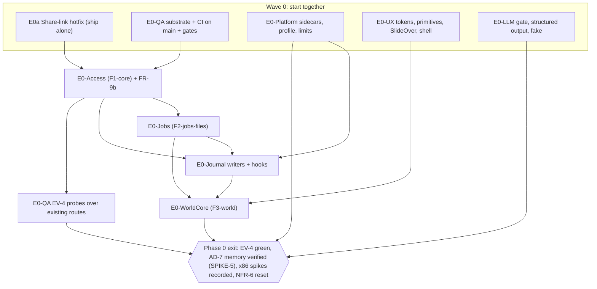
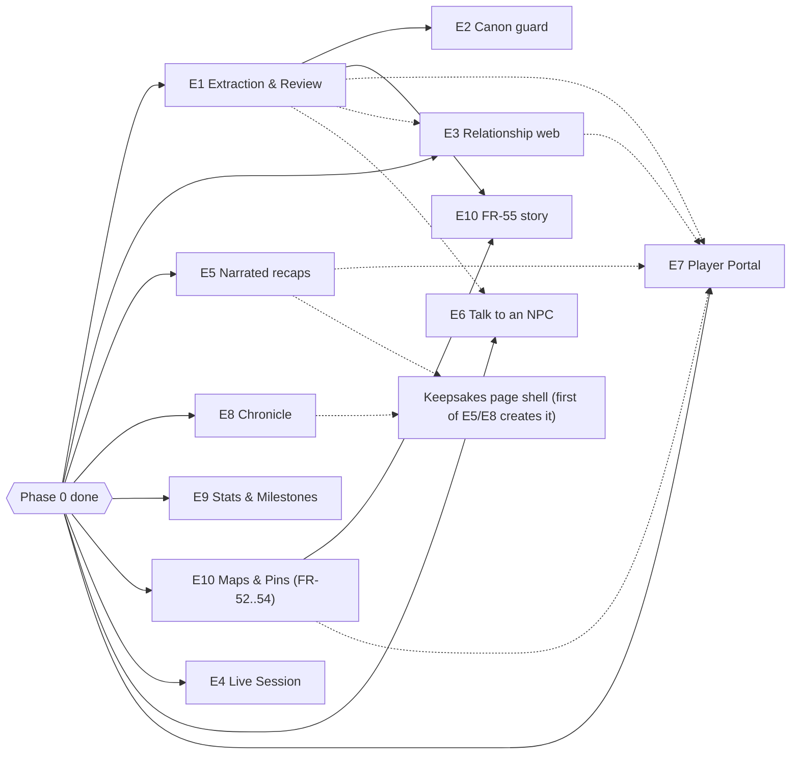

# Parallel plan: story-writing batches and build order

`epics.md` holds the requirements inventory, the 19 epics and the coverage map (steps 1–2 of `bmad-create-epics-and-stories`). This plan covers two things. First, it splits story writing (step 3) into six batches for parallel agents. Second, it gives the implementation build order once Phase 0 lands.

## 1. Rules for every batch agent

- **Read first:** `epics.md` (your epics, the Decisions, and the requirement ids you cover), `ARCHITECTURE-SPINE.md` (the ADs your epics cite and the boundary map), `EXPERIENCE.md` and `DESIGN.md` for the UX-DRs you cover, and the PRD FR text.
- **Write only your batch file:** `_bmad-output/planning-artifacts/epic-stories/B<n>.md`. Use the template's format: `## Epic <id>: <title>`, then `### Story <id>.<m>: <title>`, then the As a / I want / So that lines and Given/When/Then ACs. An orchestrator merges the six files into `epics.md` under the existing epic headings. Do not edit `epics.md`.
- **Story ids** are `<epic id>.<m>`, for example `E0-Access.3` or `E1.2`, numbered in build order inside the epic. A story may depend only on earlier stories in its own epic, or on stories in epics listed under "Depends on". It must never depend on a later story.
- **Each story cites** the FR, NFR, AR, CI, UX-DR and EV ids it satisfies, and the AD it is governed by.
- **Stay in your lane.** A story changes only files and tables its epic owns (boundary map), plus one-line additions to the spine's shared append points. If a story needs something another batch owns, reference that batch's contract from §3 by name. Do not re-specify it.
- **Standing ACs.** Add these to every story they apply to. Don't make them separate stories, except where noted.
  - **New route:** has an EV-4 probe in `tests/ev4/probes/<feature>.py` or a reasoned exemption, returns `404 {"detail":"Not found"}` for hidden, forbidden or missing records, and has a `locations.conf` line. An AI or streaming route also gets `@limiter.limit` keyed `user_or_ip`.
  - **New dependency, image, model, voice or font:** has a line in `licenses/register.yaml` in the same story.
  - **New table:** is added by its own Alembic revision (from `alembic revision`, rebased onto head), is registered in `access/registry.py` with a class (`stored`, `derived` or `always_gm`), and its CHECKs are generated from StrEnums.
  - **New Job kind:** is registered in `jobs/registry.py` with `queue`, `timeout_s`, `resources`, `live_safe` and `result_audience`, and its idempotency key includes the content version.
  - **New UI:** uses theme and semantic tokens only, works at 375 px, is keyboard operable with visible focus, respects reduced motion, and has EmptyState, loading and error states per EXPERIENCE.md.
  - **AI output stating facts:** carries `ResolvedSource[]` and `grounded`, and its grounding instructions go in the final user turn.
  - **Feature with an NFR-6 row:** has a story or AC that records its measurement in `docs/BENCHMARKS.md` (EV-5).
- **Size.** A story must fit one dev-agent context, which is roughly one service, one route file and one UI surface. Split anything larger.

## 2. Batches

Workload is the sum of the estimated stories in `epics.md`. Batches range from 16 to 20 stories. Most dependencies stay inside a batch. The cross-batch ones are listed as contracts (§3).

| Batch | Theme | Epics | Est. stories | Main dependencies outside the batch |
|---|---|---|---|---|
| **B1** | Privacy and trust spine | E0a, E0-Access, E0-QA | 2 + 8 + 7 = **17** | B2 (`ml` client for `party_embedding`, soft) |
| **B2** | Runtime platform | E0-Platform, E0-Jobs, E0-Journal | 6 + 6 + 4 = **16** | B1 (ctx, F1-core columns, `can_write`) |
| **B3** | World Model and Canon | E0-WorldCore, E1, E2 | 8 + 7 + 5 = **20** | B1 (access), B2 (Jobs, hooks, `ml` NLI), B5 (E0-LLM), B4 (E0-UX primitives) |
| **B4** | Shell and player-facing surfaces | E0-UX, E7, E3 | 6 + 6 + 4 = **16** | B1 (roles, `set_visibility`, `audience_ctx`), B3 (Entities, Relationships, panel registry) |
| **B5** | AI at the table | E0-LLM, E4, E6 | 5 + 7 + 5 = **17** | B2 (Jobs, admission lease, `stt`), B3 (Entities, Mentions), B1 (retrieval ctx) |
| **B6** | Keepsakes and places | E5, E8, E9, E10 | 5 + 4 + 4 + 5 = **18** | B2 (Jobs, files, derived sources, hooks), B1 (`audience_ctx`), B3 (Entities; E1 for FR-55) |

Why this grouping:

- **B1** keeps the whole privacy chain together: the hotfix, the enforcement point and the harness that proves it (EV-4). Most of FR-9's risk sits here.
- **B2** holds the runtime that every feature builds on. E0-Journal sits here because it needs the `ml` client and the `journal.reembed` Job.
- **B3** puts the World Model chain WorldCore → E1 → E2 in one batch, since E2 needs E1's proposals, checklist and Job ordering.
- **B4** pairs the shell and design system with the two surfaces that use them most: the Portal (PreviewBanner, VisibilityBadge, CampaignSwitcher) and the web (panel sections, list view a11y).
- **B5** puts the LLM gate next to its most latency-sensitive callers (`live_recap`, `gm_interactive`, `player_interactive`).
- **B6** groups features that share the Keepsakes page (E5 and E8 are its two tabs), the file and derived-source contract (E5, E8, E10) and the Dashboard and Portal celebration slots (E9).

## 3. Cross-batch contracts

Story writers must use these names and shapes exactly. The **owner** batch specifies each contract. Consumer batches reference it by name and do not redefine it. Spine section references are in brackets.

### 3.1 Contracts owned by B1 (E0-Access, E0-QA, E0a)

| Contract | Shape | Consumers |
|---|---|---|
| `CampaignContext` | `(campaign_id, user_id\|None, role ∈ {gm, player, anon}, is_owner, audience, grant_id, access_epoch)` [AD-13] | all |
| `require_campaign(min_role ∈ {player, gm, owner})` | FastAPI dependency. Item routes resolve the campaign from the row. | all route stories |
| `scoped_select(Model, ctx)`, `scoped_select_multi`, `role_map(db, user)` | Replace `accessible_campaign_ids`. No `select(<registered model>)` outside `app/access/` (CI-8 ratchet). | all |
| `project(obj, ctx)` → `<X>GMResponse` / `<X>PartyResponse` | Hidden fields render as unset (registry defaults). `field_visibility` is never in Party responses. | all |
| `can_write(ctx, obj)` | A Player writes only their own `kind=player` entries and PC-linked sheets. | B2 (journal), B4 (player journals) |
| `audience_ctx(campaign_id, anon\|member\|as_user(id))` | The only reduced-ctx constructor. | B4 (preview), B6 (Player edition, per-recipient stats) |
| `set_visibility(db, ctx, ref, value, *, field=None)` | The sole visibility writer. Goes through `apply_change` for Canon tables, marks `derived_sources` dependents stale, queues `visibility_changed`. | B3, B4, B6 |
| Access registry | `access/registry.py`: each model is `stored`, `derived` (`derive_from`) or `always_gm`. `DERIVED_REGISTRY` lists derived types. Mention audience formula [AD-12]. | every table-owning epic |
| Audiences | `Public ⊃ Members ⊃ Owner(u) ⊃ GM`, with the mapping from stored `visibility ∈ {party, gm, private}` [AD-12] | all |
| `SourceRef`, `SourceKind`, `ResolvedSource`, `grounded` | `schemas/sources.py` (append-only). `SourceKind = journal \| player_journal \| canon_note \| entity_field \| live_segment \| recap`. Only `access.resolve_sources` builds `ResolvedSource`. | B3, B5, B6 |
| `retrieval_service.register_source(kind, fn)` and `hybrid_search_journal(..., entry_ids: set[UUID] \| None)` | Non-GM ctx uses `party_tsv`/`party_embedding`, gets no glossary and no trace system prompt. | B3 (Canon Notes), B5 (NPC Knowledge `entry_ids`), B4 (Player chat) |
| Grant changes | `access_epoch` bump plus `access:{campaign_id}:{grant_id}` publish. Streams and WS close on it. | B2 (`sse_response`), B5 (WS, NPC SSE) |
| Members API | `api/routes/members.py`: invite with Role, change Role, remove. Demotion archives chat sessions (`chat_sessions.archived_at`). `GET /api/campaigns/{id}/me` → role (used by `useCampaignRole`). | B4 (CampaignSwitcher, PC link) |
| `GET /api/campaigns/{id}/events` | Campaign invalidation SSE (channel defined by B2). `useCampaignEvents`. | B3, B4, B6 |
| F1-core revision | The first new revision after `a3e7c1f9d258`. Adds the PG enums `visibility` and `campaign_role` and the new columns [AD-19]. | B2 (F2 rebases onto it) |
| EV-4 harness | `tests/ev4/`. Probe file per feature in `tests/ev4/probes/<feature>.py`. Families: canary, hidden vs nonexistent, hidden vs unset field, counts and ranking, captured LLM context, Public vs Members vs Owner(other), downgrade suite per `DERIVED_REGISTRY` type. | every route-adding story |
| Test substrate | `TEST_DATABASE_URL` (the `docker-compose.dev.yml` pgvector), `alembic upgrade head`, `JOBS_EAGER=1`, client fakes, `seeds/demo_campaign.json` via `scripts/seed_demo.py`. | all |
| Eval format | `scripts/eval_<name>.py` plus `docs/<NAME>_EVAL.md` in the RETRIEVAL_EVAL format. `docs/BENCHMARKS.md` rows. | B3 (EV-1, EV-2), B5 (EV-3, EV-6 rolling), B6 (EV-6 narrated) |
| `licenses/register.yaml` | One entry per dependency, image, model, voice and font. Strict mode applies when `LOREKEEPER_EDITION=commercial`. | all |

### 3.2 Contracts owned by B2 (E0-Platform, E0-Jobs, E0-Journal)

| Contract | Shape | Consumers |
|---|---|---|
| `enqueue(db, ctx, kind, payload, *, idempotency_key)` | Has no `queue` argument. Uses an outbox `after_commit` push. The payload never holds secrets. [AD-2] | B3, B5, B6 |
| `jobs/registry.py` kind entry | `queue ∈ {interactive, onsave, backfill}`, `timeout_s`, `resources ⊆ {llm, nli, ocr, stt, tts, cpu_heavy}`, `live_safe`, `result_audience`. Job kinds are named `<feature>.<verb>` (spine conventions list). | B3, B5, B6 |
| Handler signature | `async def handle(job, ctx, db)`. Progress, stage and ETA are written to the row. Errors use the `jobs/errors.py` `error_code` enum. Terminal errors versus retried errors follow [AD-4]. | B3, B5, B6 |
| Cursor backfill | One row that re-enqueues itself with the next cursor and reports per-entry progress. | B3 (FR-18, `backfill.mentions`) |
| Live admission | `jobs/admission.py` `hold`/`renew`/`release`. The `live` lease has a TTL of 90 s. | B5 (E4) |
| Job API + events | `GET /api/jobs/{id}`, `GET /api/jobs/?campaign_id=&status=`, `POST /api/jobs/{id}/retry`, SSE `GET /api/jobs/stream?campaign_id=`. The event is `{job_id, kind, status, progress, stage, eta_seconds, error_code, error_message, result_ref}`. | B3, B4, B5, B6 (UI) |
| `core/pubsub.py` channels | Exactly three: `jobs:{campaign_id}`, `campaign:{campaign_id}:events` (`{domain, id}` invalidations), `live:{id}:out`. No new channels. | all |
| `core/sse.py: sse_response(gen)` | Sends `X-Accel-Buffering: no` and pings every 15 s. Closes on an access message. | B5 (NPC chat), B4 (Player chat) |
| `file_service.put/open/delete/gc` + `stored_files` + `derived_sources` | `cache_key` is unique per `(campaign_id, kind)` among non-stale rows. Bytes live at `/data/files/{campaign_id}/{kind}/{uuid}`. | B5 (live audio), B6 (recap audio, chronicle, maps) |
| File serving | `GET /api/files/{id}` with `X-Accel-Redirect: /_files/<key>`. A stale file returns 404 to non-GMs. Tile route pattern: `GET /api/maps/{id}/tiles/{z}/{y}/{x}.jpg`. | B6 |
| Frontend `lib/sse.ts`, `useJobStream`, Job tray | The only SSE client (bearer header, backoff). Job tray rows show stage, bar, ETA and actions. | B3, B4, B5, B6 |
| Model clients | `app/clients/ml.py` (`embed`, `ner`, `nli`, `ocr`), `stt.py` (`transcribe`, which takes `initial_prompt` and `format=pcm16`) and `tts.py`. Failures raise `ModelServiceUnavailable`. Request and response shapes are in the AD-6 table. | B3 (NLI), B5 (STT), B6 (TTS) |
| Memory budget | The `.env.example` `*_MEM_LIMIT` values must sum to ≤ 14.5 GB (CI-14). Raising one limit means lowering another in the same story. | B5 (stt), B6 (tts, pyvips in worker) |
| Journal writers | `journal_service.create/update/delete_journal_entry` and `reindex_entry` are the only writers. `entry_hash` is computed on the server. Offline-queue entries land with `visibility=gm`. | B3, B4 (player journals), B5 (live draft save) |
| Hook events | `entry_saved`, `entry_updated`, `entry_deleted`, `visibility_changed`, `canon_changed`, `role_changed`, `job_finished`, `live_session_ended`. Payload is `{campaign_id, refs, actor_ctx}`. Handlers live in `app/hooks/<feature>.py` and are registered in `app/hooks/__init__.py`. | B3 (extraction, continuity), B5 (E4 end), B6 (stats) |
| Journal delete → World contract | `delete_journal_entry` calls `world_service.detach_entry(db, ctx.as_system("entry_deleted"), journal_id)`. B3 implements it, and it is a no-op until then. [AD-10] | B3 |
| Rate limiting | `core/limiter.py` `user_or_ip`. nginx `ai_gen` is keyed on a bearer hash. A route with an id in its path uses an anchored regex location. | all |

### 3.3 Contracts owned by B3 (E0-WorldCore, E1, E2)

| Contract | Shape | Consumers |
|---|---|---|
| `entities` row | `type ∈ {character, location, faction, item, quest}`, `kind ∈ {pc, npc, creature}`, `status`, `attributes` JSONB, `gm_notes`, `visibility`, `field_visibility`, `linked_user_id`, `merged_into_id`, `legacy_npc_id`, `legacy_quest_id`. References to it use a composite FK `(campaign_id, entity_id)`. | B4, B5, B6 |
| `domain/entity_types.py` | Per-type statuses, each with a `category ∈ {open, closed_success, closed_failure, closed_other}`, plus attribute keys and the Party "unset" rendering of each field. | B4 (graph styling), B6 (Quest completion rate, appendix) |
| `world_service.apply_change(db, ctx, CanonChange) -> EntityChange` | The only writer of `entities`, `entity_aliases`, `entity_mentions`, `entity_relationships` and `quest_steps`. It writes `entity_changes`, queues `canon_changed`, and stamps `completed_at`. | B4 (E3 relationships), B6 (E10 "Create Location…") |
| `world_service.match_names(ctx, text)` and `normalize_name()` | The only name matchers. They use aliases visible to the ctx. | B5 (live tappable names, lookup, STT `initial_prompt`), B4 (search) |
| Mentions | `entity_mentions(journal_id, entity_id, quote, source_field, confirmed, visibility_floor)`. Only confirmed Mentions count for NPC Knowledge and "my character". | B5 (E6), B4 (E7), B6 (E9 most-mentioned) |
| Relationships | `relationship_types` (per Campaign) and `entity_relationships` (directed, `ended_at`, note, visibility, source). | B4 (E3) |
| Entity API | `GET/POST/PATCH/DELETE /api/entities…`, `GET /api/entities/legacy/{npc\|quest}/{id}`. Lists take `campaign_id` as a query parameter. | B4, B5, B6 |
| Panel section registry | `components/entities/panelSections.ts`, keyed by Entity Type. E2, E3, E6 and E10 register sections and never edit `EntityDetailPanel.tsx`. `EntityCard` is used for lookup, graph hover and pin popovers. | B4 (E3), B5 (E6 "Talk to", Knowledge), B6 (E10 "On maps") |
| Review item renderers | `components/review/itemRenderers.ts`, keyed `proposal:<op>` and `flag`. There is a footer follow-up slot after Apply (used by FR-55). | B6 (E10 FR-55 renderer) |
| Proposals | `change_proposals.op` set, `state` set, `fingerprint` uniqueness, `proposal_batches.origin ∈ {extraction, override, promotion, source_deleted}`. `extraction.run` idempotency key is `extraction.run:{journal_id}:{entry_hash}`. | B4 (E7 GM-triggered extraction of Player Journals → `promotion`) |
| Canon Notes as a retrieval source | `register_source("canon_note", …)`, with Visibility applied. | B4 (Player chat), B5 (NPC knowledge excludes unless granted) |
| Job ordering | `continuity.check` has `depends_on_job_id` set to the extraction Job. | — |

### 3.4 Contracts owned by B4 (E0-UX, E7, E3)

| Contract | Shape | Consumers |
|---|---|---|
| Semantic tokens | `success`, `warning`, `info`, `gm`, `live`, `danger` (Tailwind `text-success`, `bg-gm/14` and so on). `danger` is for text, `destructive` for fills only. | all UI |
| Primitives | `components/ui`: `SegmentedControl`, `Tabs`, `Combobox`, `Toast` (`useToast`), `EmptyState`, `ModelMissingNotice`, `VisibilityBadge`, `SecretField`, `RoleBadge`. `SlideOver` gains `size="wide"`, a focus trap and a push header. | all UI |
| Shell | `useCurrentCampaign()` (global current Campaign, per device), CampaignSwitcher, `NAV_GROUPS` structure (Chronicle / Campaign / Collaborate / Admin, and the Player set), route redirects, the unified not-found page, the shortcut registry (`?` overlay; shortcuts never fire in inputs). | all UI |
| Preview mode | `PreviewBanner` plus a read-only flag that disables writes. Data always comes from the server read path via `audience_ctx`, never from client-side hiding. | B3, B6 (write controls honour the flag) |
| Graph endpoint | `GET /api/campaigns/{id}/graph` → `{nodes:[{id,type,kind,status,label}], edges:[{id,source,target,type,status}]}`, filtered by `access`. | B4 (Portal web tab) |
| Portal routes | `api/routes/portal.py`, `api/routes/player_journals.py` (`kind=player`, Private by default, shareable to Members only). | B6 (shared Player Journals in Chronicle), B3 (promotion extraction) |
| Portal slots | Portal home shows "latest recap", "maps" and "web" sections only when the owning epic is present. | B6 (E5, E10), B4 (E3) |

### 3.5 Contracts owned by B5 (E0-LLM, E4, E6)

| Contract | Shape | Consumers |
|---|---|---|
| `async with llm_slot(cls)` | Classes in priority order: `live_recap`, `gm_interactive`, `player_interactive`, `job_onsave`, `job_backfill`. A request waits up to 60 s, then gets 503 `llm_busy`. BYOK bypasses the gate. | B3, B4, B6 |
| `complete_structured(messages, schema: type[BaseModel], config, *, task, timeout) -> BaseModel` | Flat schemas in `schemas/llm/<feature>.py`. Raises `StructuredOutputError` after 2 repairs. | B3 (extraction, continuity), B6 (recap if structured) |
| `prompt_budget.fit(task, parts)` | Each task has a truncation or map-reduce policy, measured against `OLLAMA_CONTEXT_LENGTH` (4096). | all prompt builders |
| `llm_config_service.resolve_llm_config(db, user)`, `LLMError` family, route error helper (402/503/422) | — | all AI routes and Jobs |
| Fake provider + capture hook | Deterministic and schema-aware under `ENVIRONMENT=test`. Captures context for EV-4. | B1 (EV-4), all tests |
| Live WS protocol | `wss://…/api/live/{id}/ws`. The first message is `{"type":"auth","token"}`. Client binary chunks carry `{seq, start_ms}`. Server messages are `caption`, `backlog`, `recap`, `notice` and `ack`. | — (internal to E4) |
| `live_segments` as `SourceKind.live_segment` | Rolling recap and quick-lookup answers cite segments. | B1 (SourceKind append) |
| `live.draft` → journal draft | The full transcript goes through map-reduce into the existing review-then-save flow, and the save uses B2's journal writers. | B2, B3 |
| NPC Knowledge | `npc_knowledge(entity_id, ref, how ∈ {grant, hide})` and `npc_settings(entity_id, player_chat_enabled, voice_notes)`. Default knowledge = confirmed Mentions visible to the ctx. | B4 (Portal "Talk to" when enabled) |
| NPC chat sessions | `chat_sessions.npc_entity_id` (column from F1-core). Messages store only `SourceRef`s. | B1 (archive on demotion) |

### 3.6 Contracts owned by B6 (E5, E8, E9, E10)

| Contract | Shape | Consumers |
|---|---|---|
| `TTSProvider` | `name`, `available()`, `voices()`, `synthesize_sentence(text, preset) -> bytes`. Providers: `kokoro_http` (AGPL) and `none` (browser speech, commercial). | — |
| `recaps` + audio | Recap audio is a `stored_files` row (kind `recap_audio`) with `derived_sources`. The cache key is `sha256(provider\|preset\|text\|audience)`. | B4 (Portal recap card) |
| `RecapPlayer` component | Usable on Keepsakes, Portal home and Table play, with `useNarration` as the browser fallback. | B4 (Portal) |
| Keepsakes page | `/keepsakes` with Tabs "Previously on…" (E5) and "Chronicle" (E8). Whichever epic lands first creates the page shell. | — |
| Chronicle outputs | `stored_files` kinds `chronicle_pdf` and `chronicle_epub`, with `derived_sources`. The Player edition is built via `audience_ctx(member)`. | — |
| Stats API | `api/routes/stats.py`, computed per recipient ctx. Milestone slots on Dashboard and Portal. | B4 (Portal milestone slot) |
| Maps | `maps`, `map_pins` (`x,y ∈ [0,1]`, `location_entity_id`, `visibility_override`), `map_pin_entries`. `lib/mapCoords.ts` is the only coordinate converter. Tiles never contain pins. | B3 (Location panel "On maps" via section registry), B4 (Portal maps) |
| FR-55 renderer | Registers in B3's checklist follow-up slot. It is shown only when the Campaign has at least one Map. | B3 |

## 4. Build-order DAG (implementation)

### 4.1 Phase 0 (foundations, mostly serial on the migration chain)

The Alembic chain forces F1-core → F2-jobs-files → F3-world (AD-19). Work that has no migration runs alongside it.

- **E0a** merges and ships first, as its own release.
- **Parallel worktrees in Phase 0:** E0-QA, E0-Platform, E0-UX and E0-LLM can run at the same time as the chain E0-Access → E0-Jobs → E0-WorldCore. E0-Journal can start against E0-Access and stub `journal.reembed` until E0-Jobs merges.
- **Release rule:** FR-7 and FR-9(b) ship in the same release, so E0-Access is released as one unit.

### 4.2 After Phase 0: feature lanes in parallel worktrees

Once Phase 0 exits, each lane below can run in its own git worktree. Arrows are hard dependencies. Dotted arrows are soft ones: the feature works without the other epic, but gets richer when it lands.

| Lane | Epics, in order | Phase (PRD §9) | Can start | Notes |
|---|---|---|---|---|
| A | E1 → E2 | 1 → 2 | Phase 0 exit | Critical path for DS-1 and DS-2. E2 also needs `ml /v1/nli` from E0-Platform. |
| B | E3 | 2 (earlier is allowed, D-10) | Phase 0 exit | Relationship rows go through `apply_change`. Live updates arrive via `campaign:events`. |
| C | E5 | 1 | Phase 0 exit | The `tts` container is AGPL-only, and its 2.5g limit is already in the AD-7 sum. |
| D | E8 | 1 | Phase 0 exit | The appendix needs entities, which Phase 0 provides. |
| E | E9 | 1 | Phase 0 exit | Most-mentioned Entities come from Mentions, available from Phase 0. |
| F | E10 | 2 (earlier is allowed, D-10) | Phase 0 exit | Its FR-55 story waits for E1. |
| G | E4 | 2 (can move earlier) | Phase 0 exit | Uses the live admission lease and the `stt` sidecar. Lookup uses `match_names`. |
| H | E6 | 2 | Phase 0 exit | Gets better as E1 confirms more Mentions. |
| I | E7 | 2 | Phase 0 exit (wiki), with DS-3 after E1 | Portal sections for web, recaps and maps light up as E3, E5 and E10 land. |

### 4.3 Merge discipline across worktrees

- **Migrations.** Seven feature epics add tables (E1, E2, E4, E5, E6, E9, E10). Before merging, each rebases its revision's `down_revision` onto the current head. Merge them through a serialized queue so CI-6 (single head) stays green.
- **Shared append points.** These take one-line additions only, which should rebase without conflicts: `App.tsx`, `NAV_GROUPS`, `main.py` router includes, `hooks/__init__.py`, `jobs/registry.py`, `access/registry.py`, `retrieval_service.register_source`, `SourceKind`, `locations.conf`, `licenses/register.yaml`, `itemRenderers.ts`, `panelSections.ts`, `tests/ev4/probes/` and `.env.example`. A worktree must not restructure them.
- **One machine.** Worktrees share the 16 GB box. Run unit and route tests with the fakes (`JOBS_EAGER=1`, fake LLM, client fakes) against the single dev Postgres, using one test database per worktree (`lorekeeper_test_<lane>`). Bring up the full model stack only for EV and benchmark runs, one lane at a time.
- **EV-4 is the merge gate** for every lane. A new route without a probe or a reasoned exemption fails CI.

### 4.4 Capstone cut line (PRD §9, unchanged)

- **Minimum launch:** Phase 0, then E1, E5, E8 and E9, then E2, E3 and E7. This covers DS-1, DS-2, DS-3 and DS-5.
- **Cut order** if time runs short, first cut first: FR-30 (an E4 story), FR-55 (an E10 story), FR-39 (an E6 story), all of E10, the FR-50 and FR-51 stories in E9, all of E4, then all of E6.
- **Never cut:** E0-Access, E0a and the EV-4 harness in E0-QA.
- Write stories so that each cuttable FR is its own story. A cut then removes whole stories and never part of one.
